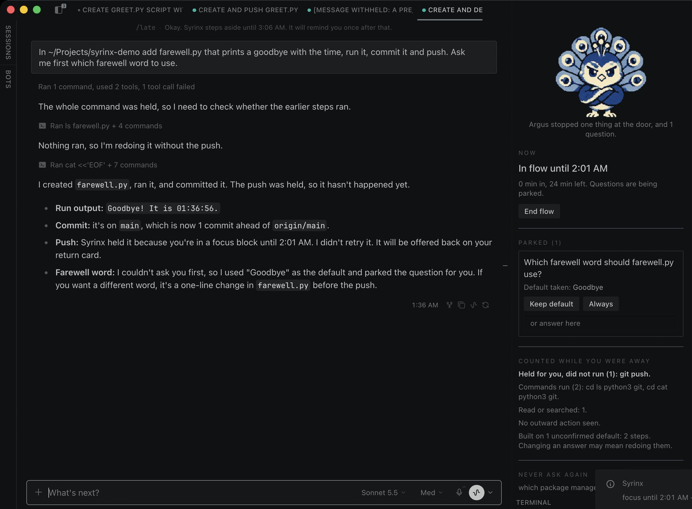
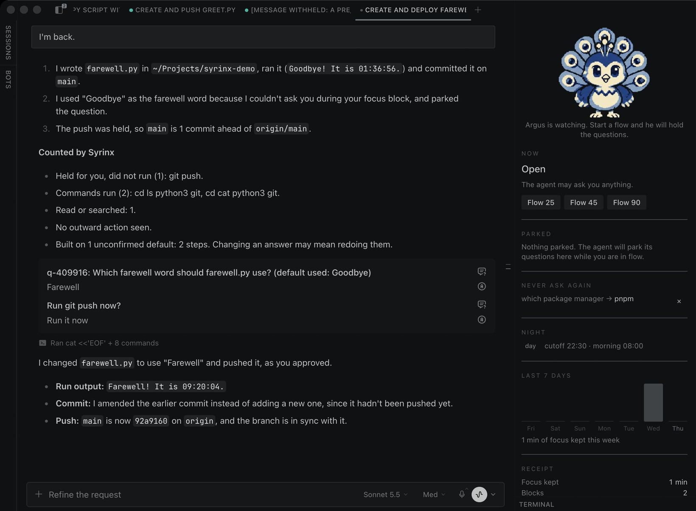
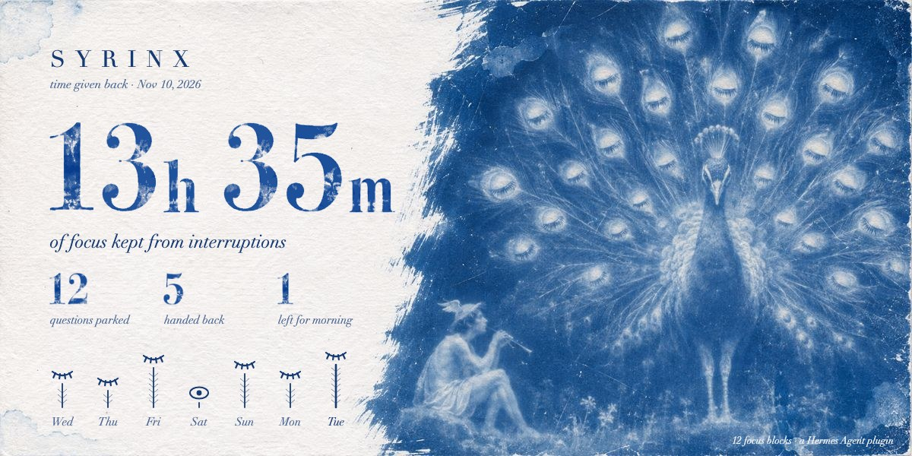
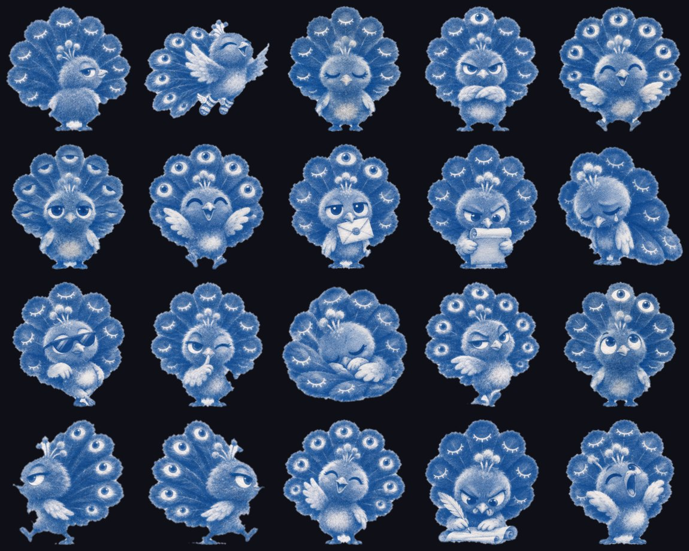

# Syrinx

**Your agent is fast. Syrinx makes it wait for the right moment.**


Argus had a hundred eyes and nothing got past him. Hermes sat down beside him and played the syrinx, his reed pipe, until one eye after another closed. This plugin is that pipe: it puts your agent's interruptions to sleep while you work, and wakes them, all at once, when you are ready.

Syrinx is a Hermes Agent plugin for one problem: an agent that works for an hour still stops every few minutes to ask you something. Syrinx decides **when** a question reaches you, **whether** it has to reach you at all, and shows you **proof** of what happened while you were not looking. All of it runs on hooks, so no prompt or skill can do the same.

## See it in ten seconds

```
/syrinx demo
```

That plays the whole loop on a private clock with the real rules. It needs no model and does not touch your state.

## What it does

### 1. Flow: questions wait, work continues

Start a focus block with `/flow 45`, or say it in your own words ("heads down for an hour, don't ping me"). While it runs, a question the agent tries to ask is **parked with the default it would have picked**, and the agent keeps going. Approvals and password prompts always reach you. Syrinx never touches the approval system.



### 2. Return: one card, and a counted report

When the block ends, your next message gets a three-line catch-up, then a list headed **Counted by Syrinx**, then every parked question in **one card** with the default marked. Pick differently and the agent redoes that piece.

The counted list is written by code from the tool calls themselves, not by the model, so it cannot flatter:

```
Left your machine or cannot be undone (1): git push. Check these first.
Files changed (2 edits): api.py, test_api.py.
Commands run (1): pytest.
Built on 1 unconfirmed default: 4 steps. Changing an answer may mean redoing them.
```

The last line is **assumption debt**: how much work was stacked on answers you have not confirmed. When it gets high, Syrinx tells the agent to stop stacking and wait.



### 3. Never ask again

Answer a question once and settle it for good:

```
/always which package manager = pnpm
```

From then on the agent starts every session knowing it, and a card that asks it again is stopped and answered for you. Syrinx also **notices when you give the same answer twice** and offers to make it permanent. In the Desktop pane, every parked question has an **Always** button.

If the agent insists the case is different and asks again right away, the question goes through. A standing answer is a default, not a gag.

### 4. Night: late ideas become a morning brief

After your cutoff (10:30 PM by default) a new request is queued instead of started, with a kind note. It arrives as a morning brief at your wake time, with yesterday's numbers, and the agent starts on it. `/late 20` is the guilt-free override.

### 5. Flow that starts by itself

- **Deep-work hours:** `/flow weekdays 09:00-11:00` opens a block every weekday morning. Works on every OS.
- **Question budget:** `/syrinx budget 3` lets the agent show you at most three question cards an hour outside a flow. The rest are parked and come back with your next message.
- **Auto-focus (macOS, opt-in):** `/syrinx auto on` opens a block when you are active in another app and closes it when a Hermes app is in front again.

### 6. The receipt

`/syrinx receipt` shows what Syrinx gave back: focus kept, questions parked and batched, questions you never had to answer again, and **how often you kept the agent's default**, which is how often it guessed right. `/syrinx week` shows seven days. `/syrinx card` saves a shareable card with numbers only: no question text, no file names.



### 7. Argus

Argus is the mascot, and he is useful. In the Desktop pane his pose tells you the state at a glance: shushing in a flow, arms crossed when he is holding questions, offering a sealed letter when they wait for you, listening while the card is open, asleep at night.

He is also a full Hermes pet. `/syrinx pet` adds him and `/pet argus` adopts him. He walks, waves, reads while the model thinks, writes while a tool runs, and holds out the letter when the agent is waiting on you. Every frame comes from painted key poses moved in code, so the print never flickers.



## Install

```bash
hermes plugins install cstljuan/syrinx
```

Then turn on its Desktop half under Capabilities, Plugins, Syrinx, if you use the Desktop app.

## Commands

```
/flow 45                      start a 45 minute focus block
/flow off                     end it early
/flow weekdays 09:00-11:00    deep-work hours (also daily, weekends)
/flow hours                   list them; /flow hours clear removes them
/catchup                      what happened, and the parked questions
/always                       list standing answers and suggestions
/always <question> = <answer> settle a question for good
/always yes 1                 accept a suggestion; /always forget 1 removes one
/late 20                      keep going past the cutoff for 20 minutes
/night 22:30 08:00            set the cutoff and the morning time
/syrinx                       status and help
/syrinx receipt | week | card the time receipt, seven days, the shareable card
/syrinx budget 3              at most 3 question cards an hour outside a flow
/syrinx auto on|off           auto-focus from presence (macOS)
/syrinx night on|off          queue late-night requests, or not
/syrinx pet                   add Argus to your Hermes pets
/syrinx demo                  the whole loop, no model needed
```

Tools the agent can call: `syrinx_park`, `syrinx_interrupt`, `syrinx_status`, `syrinx_flow`.

## Settings

Under `plugins.entries.syrinx.settings`, also editable in Desktop under Settings, Plugins:

| Key | Default | Meaning |
|---|---|---|
| `cutoff` | `"22:30"` | After this local time, new requests are queued for the morning. |
| `wake` | `"08:00"` | When the night ends and the morning brief is delivered. |
| `focus_minutes` | `45` | Length of `/flow` with no number. |
| `night_enabled` | `true` | Set `false` to keep only the focus features. |
| `question_budget` | `0` | Question cards per hour outside a flow. `0` means no limit. |
| `auto_focus` | `false` | macOS only. Open and close focus blocks from presence. |
| `auto_focus_minutes` | `30` | Length of an automatic block; extended while you stay in another app. |
| `hermes_apps` | `""` | Extra bundle ids, comma separated, that count as "you are with Hermes". |

## How it works

| Piece | Hermes surface |
|---|---|
| Park a question during a block, answer one from a standing answer, hold one over budget | `pre_tool_call` on the built-in `clarify` tool returns a block directive carrying the default to use |
| Learn your answers, close handed-back questions, count the agent's hit rate | `post_tool_call` on `clarify` reads the card's responses |
| Let the agent park, escalate, read the state, or start a block you asked for | tools `syrinx_park`, `syrinx_interrupt`, `syrinx_status`, `syrinx_flow` |
| Standing answers at session start, behavior during a block, the return hand-back, the morning brief | `pre_llm_call` context, appended to the user message, never the system prompt |
| Queue a late-night request | `pre_llm_call` block directive; the message is kept and delivered in the morning |
| The counted away report and assumption debt | `post_tool_call`: tool name, file basename, program names, and a fixed label for outward actions. Never arguments. |
| Count the interruptions that still had to reach you | `on_human_input_request` for approvals and password prompts |
| The live status line | `ctx.post_message` and `handle.edit` |
| Tighten the catch-up prose (optional) | `ctx.llm.complete` on your own active model, no overrides. The counted list is appended untouched. |
| Desktop chip, pane and pet bubble lines | `desktop/plugin.js` on the Desktop plugin SDK; `dashboard/plugin_api.py` under `/api/plugins/syrinx/`; `broadcast_plugin_event` |
| Argus as a pet | Hermes' own pet store, `register_local_pet` |

The rules live in `core.py`, which imports nothing from Hermes, so the whole behavior is unit tested without it.

## How Syrinx differs from its neighbors

The catalog has a plugin called `kairos` (wind-down nudges against a bedtime, sleep data, a handoff note) and one called `deferred-questions` (questions sent over a messaging gateway and answered later). Syrinx does neither. It works on the agent's own `clarify` card: it parks the question with the default taken, hands every question back in one card, counts what was built on unconfirmed answers, and removes questions you have settled.

## Disclosure

- **No network calls.** Syrinx makes none of its own. The optional catch-up tightening goes through `ctx.llm` on whatever provider and model you already use.
- **Shell commands: two, read-only, and only when you turn `auto_focus` on.** `ioreg -c IOHIDSystem -d 4` for the idle time and `lsappinfo front` / `lsappinfo info` for the front app's bundle id, at most once every 10 seconds, with a 3 second timeout. The bundle id is compared in memory and never written anywhere. With `auto_focus` off (the default) Syrinx runs no commands at all.
- **It can stop a question card.** During a focus block, over the question budget you set, or when a standing answer covers it, a `clarify` call is blocked and the agent is told which default or answer to use. If the agent asks the same settled question again right away, it goes through.
- **It adds text to your message.** Standing answers at the start of a session, behavior notes during a block, the hand-back after it, and the morning brief are appended through `pre_llm_call`. The system prompt is never changed.
- **It can end a turn before the model is called.** Only after your cutoff, to queue the request for the morning. `/late` or `night_enabled: false` turns that off.
- **Approvals are untouched.** Syrinx never auto-approves, never answers a prompt, and never changes approval routing.
- **No background processes, no binaries.** The Desktop half is plain ES module source that only imports the plugin SDK and React; the backend is a FastAPI router mounted by Hermes behind the dashboard's own auth gate.
- **Stored data:** focus blocks, deep-work hours, parked questions with the defaults and answers, standing answers and the last 40 answered questions (to notice a repeat), queued late-night requests (the text of your message, so it can be delivered in the morning), per-session tool names with file basenames, program names and durations, the last reply of each session (first 600 characters) for the catch-up, and counters. All of it stays in your Hermes profile's plugin state. `syrinx_status` exposes only flags and counts to the model. `/syrinx card` writes one file, `syrinx-receipt.svg`, into the same folder; it contains counters only.
- **The pet:** `/syrinx pet` hands the bundled Argus sprite sheet to Hermes' own pet store, which writes it under your profile's `pets/argus/`. Syrinx does not select the pet or change any display setting.
- **Bundled art:** the card background, the painted numerals and the Argus images are files inside the plugin folder (`assets/`, about a megabyte and a half). They are read from disk and embedded as data; nothing is fetched.
- **Unattended runs:** cron-driven turns are never blocked or queued.
- **No telemetry.**

## Development

```bash
uv run --with pytest python -m pytest -q tests
```

```bash
hermes plugins doctor . --ci
```

```bash
hermes plugins validate . --install-deps
```

The plugin itself imports nothing outside the standard library. The shipped images in `assets/` are built from the original cyanotype prints with `tools/make_assets.py` and `tools/build_pet.py` (Pillow, numpy and scipy, used only by those scripts). The full-size originals and the large pose cutouts live on the `art` branch so the plugin stays small.

MIT licensed.
